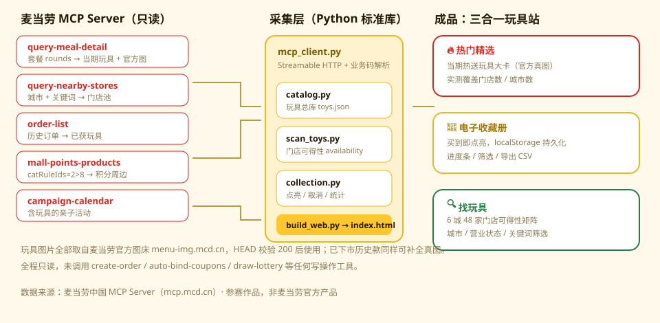

# 麦麦玩具收藏册 · MCD Happy Meal Toy Collection

基于**麦当劳中国 MCP Server** 的「开心乐园餐玩具」电子收藏册：买了开心乐园餐、拿到哪款玩具，就在收藏册里点亮它；同时能看当前门店**正在送哪款玩具**，以及按门店**找玩具**。

所有数据均来自麦当劳官方 MCP 实时接口，无爬虫、无 mock。



> 实测样本：6 城 48 家门店扫描 → 当期主推「海绵宝宝×航海王系列玩具」覆盖 15 家门店 / 4 座城市。

---

## 功能

| 功能 | 说明 | 数据来源 |
|---|---|---|
| 🎯 **当前热送** | 当期联名玩具大卡（官方图 + 选配轮次 + 实测覆盖门店/城市数 + 一套几款） | `query-meal-detail` + 跨城 `availability.json` |
| 📖 **电子收藏册** | 按「当前在送 / 历史款 / 积分周边」三组呈现；**系列卡按单品点亮**（点芯片点亮、✎ 起名、＋ 添加），进度条、搜索、分类/状态筛选、导出 CSV | `data/toys.json` + `data/collection.json` |
| 🔍 **找玩具** | 6 城 48 家门店扫描，列出「哪家店在送哪款」、城市/营业状态筛选 | `scan_toys.py` → `data/availability.json` |
| 🕓 **历史款** | 从历史订单挖出曾拿到的玩具（标注下单日期），自动入库 | `order-list` + `query-meal-detail` |
| 🎁 **积分兑换** | 麦麦商城可积分兑换的玩具与联名周边 | `mall-points-products`（`catRuleIds=2>8`） |
| 📅 **相关活动** | 提到玩具/乐园餐的官方活动 | `campaign-calendar` |

当前玩具库共 **7 款 / 25 个可收集单品**：当前在送 2（海绵宝宝×航海王系列一套 10 款、随机玩具）、历史订单 2（樱桃小丸子定制玩具 6 款、小马宝莉&变形金刚系列 6 款）、积分兑换周边 3（酸黄瓜吧唧礼盒、罗技键鼠套装、Nike Book 2 麦当劳特别联名款）。

### 点亮单位是「单品」不是「系列」

每份开心乐园餐含**随机玩具 1 个**（官方系列图原话），拿到的是整套里的一款，所以收藏册按单品点亮：

| 系列 | 一套几款 | 说明 |
|---|---|---|
| 海绵宝宝×航海王系列玩具 | 10 | 当期主推，跨城扫描 15 家门店在送 |
| 樱桃小丸子定制玩具 | 6 | 历史订单获得 |
| 开心乐园小马宝莉&变形金刚系列玩具 | 6 | 历史订单获得 |
| 随机玩具1个 | 不定 | 任意系列随机款，拿到哪款点 ＋ 添加哪款 |

系列内单品清单 MCP 不提供（`query-meal-detail` 只把整个系列作为一个选配项返回），单品数按**官方系列图**点数预置，单品图由 `scripts/cut_toys.py` 从官方系列整图**逐款切割**得到，名字默认取官方联名配对（可 ✎ 改）。

**玩具图片**（全部为官方图床真实资源，无占位图；构建时下载到 `web/assets/` 本地化，页面不依赖外链）：
- 在售款：取 `query-meal-detail` 对玩具 code 返回的 `image`；
- 历史 / 下市款：按官方图床规则 `https://menu-img.mcd.cn/pcm/prod/menu/ProductPool/product/MS_<code>_600.png` 兜底，HEAD 校验 200 才采用（`mcp_client.guess_image`）；
- 积分周边：直接取 `mall-points-products` 返回的 `spuImage`；
- **单品图**：`cut_toys.py` 按 alpha 投影定位系列整图里的每个单品单元格（透明背景、两行网格、底部红字排除在外），裁剪 + 紧致 trim 输出透明 PNG 到 `web/assets/toys/`，并在 `data/slot_images.json` 记录槽位名。系列卡左侧仍显示**完整系列整图**，下方每个单品槽位配各自的切割图：点亮后彩色显示，未点亮灰度。

**交互实现**：三个页签用 `radio + :checked` 纯 CSS 切换，不依赖 JavaScript；收藏状态存 localStorage，并对 localStorage 不可用（沙箱 iframe / 隐私模式）做了 try/catch 兜底，两种环境下点亮、筛选、导出均可用（已用无头浏览器在"禁 localStorage"环境下回归测试通过）。

实测样例：6 城 48 家门店扫描，识别出 **海绵宝宝×航海王系列玩具**（覆盖 15 家门店 / 4 座城市）与**随机玩具**（成都 4 家门店）。

---

## 快速开始

### 1. 准备 MCP Token

在 [麦当劳 MCP 开放平台](https://open.mcd.cn/mcp) 登录（手机号 + 短信验证码）→ 右上角【控制台】→【激活】→ 同意协议 → 复制 Token。

```bash
export MCD_MCP_TOKEN="你的Token"          # macOS / Linux
setx MCD_MCP_TOKEN "你的Token"            # Windows（新开终端生效）
```

> 也支持 `MCD_MCP_TOKEN_FILE=/path/to/token.txt`。若不设环境变量，脚本会回退读取 `~/.workbuddy/mcp.json` 中 `mcd-mcp` 的配置（仅本机开发方便）。
>
> 在支持 MCP 的客户端（如 WorkBuddy）里使用时，直接复制仓库中的 [`mcp-config.example.json`](./mcp-config.example.json) 并将 `YOUR_MCP_TOKEN` 替换为实际 Token 即可。

### 2. 构建玩具库

```bash
python scripts/catalog.py
```

输出 `data/toys.json`：当前在售款 + 历史款 + 积分兑换款 + 相关活动。

### 3. 生成电子收藏册

```bash
python scripts/build_web.py
```

> 切换新系列时先跑 `python scripts/cut_toys.py`：从 `web/assets/series-src/` 的官方系列整图切出单品图到 `web/assets/toys/` 并刷新 `data/slot_images.json`，再构建页面。

双击打开 `web/index.html` 即可查看、点击点亮（状态保存在浏览器 localStorage）。

### 4. 点亮 / 查看进度（单品级）

```bash
python scripts/collection.py list                                    # 总览：系列进度 + 每款明细
python scripts/collection.py collect 521991 --slot 4 --name "派大星x乔巴" --store "麦当劳深圳方大城餐厅"
python scripts/collection.py uncollect 521991 --slot 4               # 取消某一款
python scripts/collection.py rename  521991 --slot 4 --name "新名字"  # 给某一款起名
python scripts/collection.py add 7001 --name "抽到的某款"             # 随机玩具追加一款记录
python scripts/collection.py collect 17643                           # 非系列单品（积分周边）整体点亮
python scripts/collection.py stats                                   # 进度统计
python scripts/collection.py sync                                    # 重新扫描并更新收藏册
```

网页端同理：系列卡点芯片点亮/取消、点 `✎` 起名、点 `＋` 添加；积分周边卡点按钮整体点亮。

### 5. 找玩具（跨城门店扫描）

```bash
python scripts/scan_toys.py --per-city 8                     # 默认 6 城，每城最多 8 家门店
python scripts/scan_toys.py --cities 深圳市,广州市 --per-city 12
python scripts/scan_toys.py --stores 1420544,1420207         # 指定门店精准比对
```

链路：`query-nearby-stores`(城市+行政区关键词) → `query-meals`(筛"开心乐园"分类) → `query-meal-detail`(套餐 rounds 提取玩具轮次) → 图床校验。
输出 `data/availability.json`（玩具 × 门店可得性矩阵），`web/index.html` 的「找玩具」页直接读取该文件。

> 门店检索关键参数：`searchType=2` 时 **city 与 keyword 必须同时传**，
> 只传其一返回 `600058 城市名或者关键词不能为空`；`searchType=1` 仅返回账号收藏门店。

---

## 目录结构

```
mcd-toy-collection/
├── README.md                 本文件
├── CONTEST_DECLARATION.md    参赛声明（官方原文，未改动）
├── MCP_INTEGRATION.md        MCP 调用说明与业务价值
├── SKILL.md                  WorkBuddy Skill 定义
├── workbuddy.md              使用 WorkBuddy 开发的对话上下文
├── mcp-config.example.json   脱敏 MCP 配置示例（仅占位符，符合参赛要求）
├── .env.example              Token 占位示例（不含真实凭证）
├── scripts/
│   ├── mcp_client.py         MCP 调用封装（Streamable HTTP + 业务状态解析 + 图床校验）
│   ├── catalog.py            构建玩具总库（当前/历史/商城/活动）
│   ├── scan_toys.py          跨城门店扫描 → 玩具可得性矩阵
│   ├── cut_toys.py           官方系列整图 → 单品切割图（web/assets/toys/）
│   ├── collection.py         收藏册 CLI（点亮/取消/统计/同步）
│   ├── build_web.py          生成 web/index.html
│   └── probe_stores.py       探测门店类工具的入参 schema（调试用）
├── docs/
│   └── architecture.svg      数据流架构图
├── data/
│   ├── toys.json             玩具总库（当前/历史/积分周边/活动，含官方图 URL）
│   ├── availability.json     跨城门店可得性（玩具 × 门店矩阵）
│   ├── slot_images.json      系列单品切割图映射（code → 槽位/名字/文件）
│   └── collection.json       点亮记录（version 2：slots 系列内单品 + single 非系列单品）
└── web/
    ├── index.html            单文件站点：热门精选 / 电子收藏册 / 找玩具
    └── assets/               本地化图片（自包含，不依赖外链图床）
        ├── series/           官方系列整图（收藏册系列卡左侧显示）
        ├── toys/             22 张单品切割图（透明 PNG，槽位芯片显示）
        ├── mall/             积分周边图
        ├── events/           活动图
        └── series-src/       切割源图（cut_toys.py 输入，可复切）
```

数据链路零第三方依赖，只用 Python 标准库（3.9+）；仅 `cut_toys.py`（切图）额外需要 `Pillow` + `numpy`，网页本身是纯静态 HTML，无任何 JS 框架。

---

## 目标用户

- 收集开心乐园餐玩具的麦当劳会员 / 亲子家庭
- 想快速知道「今天这家店送哪款玩具」再决定去哪家店的消费者
- 想了解麦当劳 MCP 能力边界、寻找 Skill 创意的开发者

---

## 已知限制（诚实说明）

1. **门店营业时间影响扫描覆盖率**：非营业时段 `query-meals` 返回 `600057 门店可能已关闭或不在营业时间`，此部分门店标记为「不可点餐」。首次实测（23:00 后）48 家门店中 17 家可点餐；白天重跑覆盖率显著提高。
2. **城市关键词召回有限**：`query-nearby-stores` 单次最多返回约 5 家门店，脚本用多个行政区关键词去重扩充；仍是抽样，不是全国全量。
3. **玩具配送基本全国统一**：本次扫描仅识别出 2 款在送玩具（海绵宝宝×航海王系列 15 家门店 + 成都随机玩具 4 家门店），跨店差异小，"找玩具"的实际价值主要体现在按距离找具体门店。
4. **收藏册玩具数量取决于账号历史**：历史款来自本账号 `order-list` 的真实订单（当前 4 单中含 3 款玩具），换账号跑会得到不同结果。
5. **系列内单品清单 MCP 不提供**：`query-meal-detail` 只把整个系列作为一个选配项返回，拿不到"一套里有哪几款、各叫什么"。单品数按官方系列图点数预置（海绵宝宝×航海王 10 款、小马宝莉&变形金刚 6 款、樱桃小丸子 6 款）；单品图由 `cut_toys.py` 从系列整图切割，单品名按官方联名阵容预填（可 ✎ 改）；换系列/换期时重跑 `cut_toys.py` 即可。
6. 数据仅供参考，餐品、价格、赠品供应状态以麦当劳官方渠道实时结果为准。

---

## 参赛信息

麦当劳程序员创意开发大赛参赛作品。非麦当劳官方产品。

### 报名前自检（依据官方《活动规则》）

| 要求 | 状态 |
|---|---|
| 仓库 Public 且创建于 2025-12-25 ~ 2026-10-25 | 待确认（创建时间需 ≤ 2026-10-25 23:59） |
| `README.md`（项目介绍、安装方法、使用示例、目标用户） | ✅ |
| `CONTEST_DECLARATION.md`（官方原文，文件名内容均不可改） | ✅ |
| `MCP_INTEGRATION.md`（MCP Server / Tool / 调用流程 / 业务价值） | ✅ |
| `mcp-config.example.json`（脱敏 MCP 配置，仅占位符） | ✅ |
| `workbuddy.md`（WorkBuddy 对话上下文，专项奖励必需） | ✅ |
| 真实调用麦当劳 MCP | ✅ 全程只读，见脚本 |
| 在活动仓库按模板提交报名 Issue（10-25 23:59 前） | ⬜ 待办 |

排名依据：**GitHub 公开 Star 数**（Star=0 不进榜），前 100 名进获奖范围；最终定榜时间 2026-10-26 00:00。
